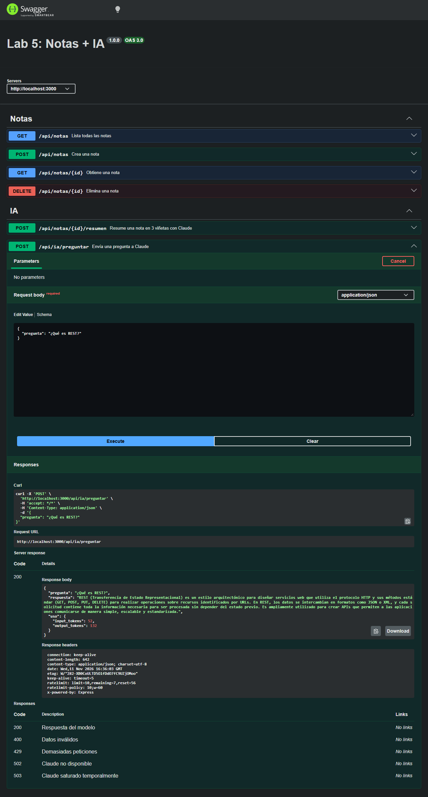
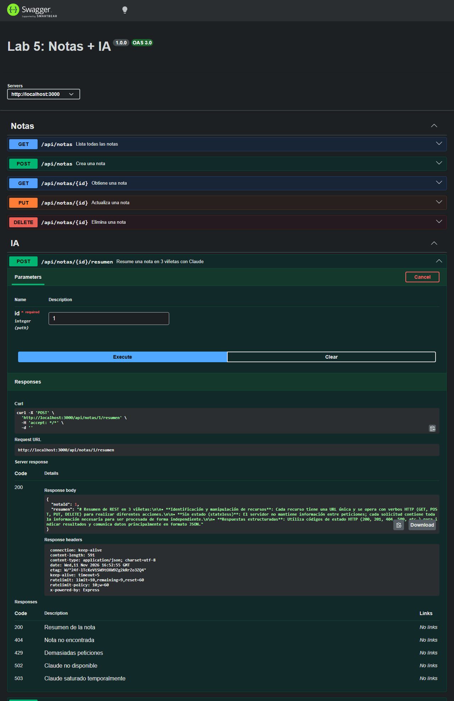
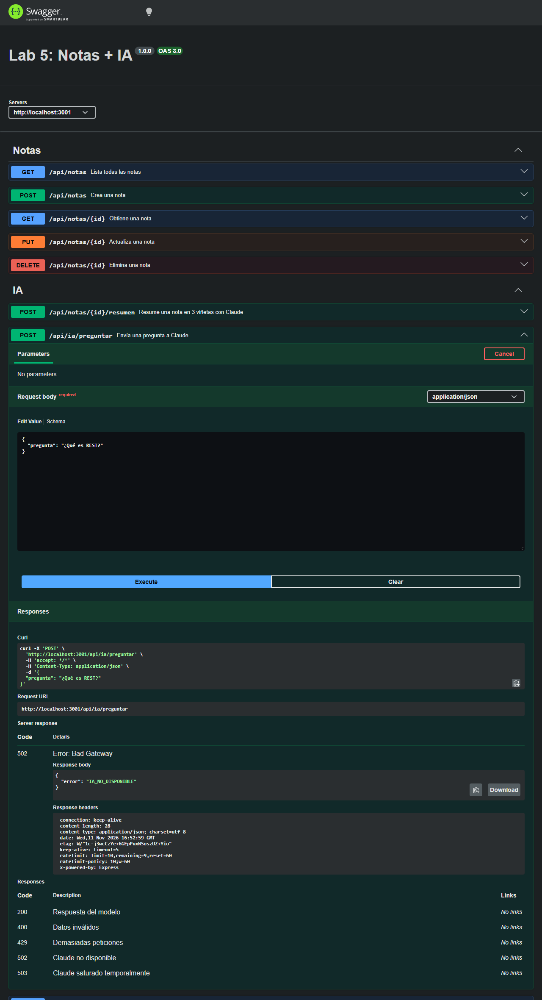

# Lab 5: API de notas con Express, Swagger y Claude

API REST para guardar notas, con dos funciones de inteligencia artificial: hacerle una pregunta libre a Claude y pedirle que resuma una nota en tres viñetas. Todos los endpoints están documentados con OpenAPI 3 y se pueden probar desde Swagger UI.

El cliente (Swagger UI o Postman) solo habla con esta API. La única parte del proyecto que habla con Claude es el backend, y la API key nunca sale del servidor.

## Integrantes

El laboratorio se hizo de forma individual, así que una sola persona cubrió los dos roles. El trabajo se mantuvo separado en las dos ramas que pide la guía, cada una con su pull request.

| Integrante | Rol | Rama | Responsabilidades |
|---|---|---|---|
| victorgonzalez246 | A · API y documentación | `feature/notas` | Express y Swagger, CRUD de notas, validación con Zod, documentación de los endpoints de notas |
| victorgonzalez246 | B · Integración con IA | `feature/ia` | API key, servicio de Claude, endpoints de IA, errores de la Claude API, documentación de los endpoints de IA |

## Requisitos

- Node.js 20 o superior (`node -v`)
- Una API key de la Claude Console (platform.claude.com → Settings → API keys)

## Instalación y ejecución

```bash
git clone https://github.com/victorgonzalez246/lab5-api.git
cd lab5-api
npm install
cp .env.example .env      # en Windows: copy .env.example .env
```

Abrir `.env` y pegar la API key en `ANTHROPIC_API_KEY`. Después:

```bash
npm run dev      # desarrollo, reinicia al guardar (nodemon)
npm start        # ejecución normal
npm test         # pruebas automatizadas, no gastan créditos
```

La documentación queda en http://localhost:3000/api-docs.

## Variables de entorno

| Variable | Para qué sirve |
|---|---|
| `ANTHROPIC_API_KEY` | Clave de la Claude API. El SDK la lee sola, no aparece en el código. |
| `CLAUDE_MODEL` | Modelo que se usa en las llamadas. Se puede cambiar sin tocar el código. |
| `PORT` | Puerto del servidor (3000 por defecto). |
| `IA_LIMITE_POR_MINUTO` | Máximo de peticiones por minuto a cada ruta de IA (10 por defecto). |

El archivo `.env` está en `.gitignore` y no se sube. `.env.example` sí se sube, sin la clave.

## Endpoints

| Método | Endpoint | Descripción | Usa Claude |
|---|---|---|---|
| GET | `/api/notas` | Lista todas las notas | No |
| GET | `/api/notas/:id` | Obtiene una nota | No |
| POST | `/api/notas` | Crea una nota (`titulo`, `contenido`) | No |
| DELETE | `/api/notas/:id` | Elimina una nota | No |
| POST | `/api/ia/preguntar` | Envía una pregunta libre al modelo y devuelve `pregunta`, `respuesta` y `uso` | Sí |
| POST | `/api/notas/:id/resumen` | Resume una nota en 3 viñetas | Sí |
| GET | `/api-docs` | Documentación interactiva (Swagger UI) | No |

Las notas se guardan en memoria, así que se pierden al reiniciar el servidor. Para que siempre haya con qué probar, al arrancar se cargan dos notas de ejemplo con los id 1 y 2.

### Respuestas de error

Todos los errores tienen la misma forma: `{ "error": "..." }`. Los de validación traen además el detalle de Zod en `errores`.

| Código | Cuándo |
|---|---|
| 400 | El body no pasa la validación o el JSON está mal formado |
| 404 | La nota o la ruta no existe |
| 429 | Demasiadas peticiones a la IA (límite propio o `rate_limit_error` de Claude) |
| 502 | Claude respondió con un error (por ejemplo 401 o 400) o falta la API key |
| 503 | Claude está saturado (`overloaded_error`, 529) |
| 500 | Cualquier otro fallo inesperado |

## Estructura

```
src/
├── config/swagger.js            especificación OpenAPI
├── routes/notas.routes.js       CRUD de notas y resumen
├── routes/ia.routes.js          pregunta libre
├── services/notas.service.js    notas en memoria
├── services/claude.service.js   único archivo que usa el SDK
├── middlewares/validar.js       validación con Zod
├── middlewares/errorHandler.js  manejo central de errores
├── middlewares/limiteIA.js      límite de peticiones a la IA
├── utils/errors.js              AppError
├── app.js
└── index.js
test/                            pruebas con supertest
docs/                            capturas de Swagger UI
```

## Capturas de Swagger UI

| Prueba | Captura |
|---|---|
| Pregunta libre en `POST /api/ia/preguntar` (200 con respuesta y uso de tokens) | [`docs/preguntar.png`](docs/preguntar.png) |
| Resumen de la nota 1 con `POST /api/notas/1/resumen` (200 con 3 viñetas) | [`docs/resumen.png`](docs/resumen.png) |
| Pregunta con una API key falsa (502 `IA_NO_DISPONIBLE`, 401 en la consola) | [`docs/clave-falsa.png`](docs/clave-falsa.png) |

### Pregunta libre



### Resumen de una nota



### Pregunta con una API key falsa

El cliente recibe un 502 genérico:



El 401 original de Claude solo aparece en la consola del servidor ([`docs/clave-falsa-consola.txt`](docs/clave-falsa-consola.txt)):

```
Claude API: 401 401 {"type":"error","error":{"type":"authentication_error","message":"invalid x-api-key"}, ...}
```

## Pruebas desde Swagger UI

| Prueba | Resultado esperado |
|---|---|
| Crear dos notas con `POST /api/notas` | 201 con id |
| Listar con `GET /api/notas` | 200 con las dos notas |
| Pedir `GET /api/notas/99` | 404 Nota no encontrada |
| `POST /api/notas` con body vacío `{}` | 400 con detalles de Zod |
| Pregunta libre en `POST /api/ia/preguntar` | 200 con respuesta y uso de tokens |
| Resumir la nota 1 con `POST /api/notas/1/resumen` | 200 con resumen en 3 viñetas |
| Resumir una nota que no existe | 404 sin llamar a Claude |
| `POST /api/ia/preguntar` con pregunta de 1 letra | 400 sin llamar a Claude |
| Cambiar la API key por una falsa y preguntar | 502 `IA_NO_DISPONIBLE`; 401 en la consola |
| `DELETE /api/notas/2` y luego `GET /api/notas/2` | 204 y después 404 |

Las mismas pruebas están automatizadas en `test/` con el servicio de Claude simulado (`npm test`).

## Experimentos con el parámetro `system`

En `POST /api/notas/:id/resumen` el contenido de la nota va en `messages` y la instrucción va en `system`. Cambiando solo ese texto, la misma nota produce resultados distintos:

| Texto de `system` | Qué cambió en la respuesta |
|---|---|
| «Resume el texto en 3 viñetas breves, en español.» | Devolvió tres viñetas, una por idea: recursos y verbos HTTP, sin estado, y respuestas con códigos y JSON. Agregó por su cuenta un título «Resumen REST». |
| «Resume el texto en una frase.» | Una sola oración larga que junta las mismas ideas (63 tokens de salida). |
| «Extrae las palabras clave.» | Ya no resumió: devolvió una lista numerada de 11 términos con una explicación corta cada uno, y repitió «Verbos HTTP». Fue la respuesta más larga (180 tokens de salida). |
| «Traduce el texto al inglés.» | Devolvió la nota completa traducida al inglés, sin resumir nada (113 tokens de salida). |

La nota de prueba fue un párrafo sobre REST. En los cuatro casos el contenido de `messages` fue idéntico (144 o 145 tokens de entrada contando el `system`); lo único que cambió fue la instrucción, y con ella cambiaron la tarea, el idioma, el formato y la longitud de la respuesta. También se nota que el modelo añade títulos en Markdown aunque no se le pidan: si se quisiera texto plano habría que decirlo en `system`.

## Preguntas de reflexión

**1. ¿Por qué la API key no puede estar en el frontend? ¿Cómo la podría obtener un usuario cualquiera?**

Porque todo lo que se envía al navegador queda en manos del usuario. Si la clave estuviera en el JavaScript del frontend, cualquiera podría abrir las DevTools y verla en la pestaña Network, en la cabecera `x-api-key` de la petición a `api.anthropic.com`, o buscarla directamente en el código fuente en la pestaña Sources. Con esa clave podría hacer llamadas a nuestro nombre y gastar los créditos de la cuenta. Por eso en este proyecto el cliente solo habla con nuestra API y la clave vive en el `.env` del servidor.

**2. ¿Qué responde la API cuando Claude devuelve 401? ¿Por qué no se reenvía ese mismo 401 al cliente?**

Responde `502` con `{ "error": "IA_NO_DISPONIBLE" }`, y el 401 original con su mensaje solo se registra en la consola del servidor. No se reenvía por dos razones. La primera es que un 401 le diría al cliente que él no está autenticado, y eso es falso: quien falló al autenticarse fue nuestro servidor frente a Claude, así que lo correcto es un 502 (un servicio del que dependemos respondió mal). La segunda es que el mensaje original puede revelar detalles internos, como que usamos Claude, que la clave es inválida o el identificador de la petición.

**3. ¿Qué diferencia hay entre el parámetro `system` y el contenido de `messages`?**

`system` son las instrucciones que le damos nosotros al modelo: su rol, el idioma y el formato de la respuesta. `messages` es la conversación, es decir, el contenido que llega del usuario. En el endpoint de resumen se ve claro: en `messages` va el contenido de la nota tal cual, y en `system` va «Resume el texto en 3 viñetas breves, en español.». La nota es la misma, pero al cambiar `system` el modelo hace otra tarea con ella (ver la tabla de experimentos). Separarlos también evita que el texto de la nota se confunda con las instrucciones.

**4. `input_tokens` y `output_tokens` de dos llamadas. ¿Qué parámetro permite limitar el costo?**

| Pregunta enviada a `POST /api/ia/preguntar` | `input_tokens` | `output_tokens` |
|---|---|---|
| «Explica en dos frases qué es un JSON.» | 56 | 89 |
| «¿Qué es REST?» | 52 | 110 |

En las dos, la salida pesa más que la entrada. La instrucción de `system` pide responder en un máximo de tres frases y en texto plano: antes de ponerla, la misma pregunta «¿Qué es REST?» devolvía títulos, listas y un ejemplo y gastaba 387 tokens de salida con solo 32 de entrada. El `system` más largo sube un poco la entrada (de 32 a 52), pero baja mucho la salida.

El parámetro que limita el costo de la respuesta es `max_tokens` (aquí 1024): el modelo no puede generar más tokens de salida que ese número. El costo de entrada lo limitamos con la validación, que no deja pasar preguntas de más de 2000 caracteres ni notas de más de 5000. También influye `CLAUDE_MODEL`, porque cada modelo tiene un precio por token distinto.

**5. ¿Qué pasaría si no validaran el body antes de llamar a Claude?**

- Se gastarían créditos en peticiones inútiles: preguntas vacías, de una letra o textos enormes llegarían a Claude y se cobrarían igual.
- Un body sin `pregunta` haría que Claude devolviera un `invalid_request_error`, y el cliente recibiría un 502 confuso en lugar de un 400 que le explique qué campo está mal.
- Cualquiera podría enviar textos gigantes una y otra vez para vaciar la cuenta, y cada petición tardaría más en responder.

**6. ¿Qué conflicto de Git hubo al integrar las ramas y cómo se resolvió?**

El conflicto fue en `src/routes/notas.routes.js`, que es justo el punto donde se unen los dos roles. Las dos ramas salieron del mismo commit (el que tenía solo las rutas para listar y crear) y las dos agregaron código en el mismo lugar, entre `POST /` y `module.exports`: `feature/notas` añadió `GET /:id`, `DELETE /:id` y la documentación, y `feature/ia` añadió la ruta `POST /:id/resumen`. Git no pudo decidir cuál bloque iba y marcó el archivo con `<<<<<<<`, `=======` y `>>>>>>>`.

Se resolvió integrando `feature/notas` dentro de `feature/ia` y editando el archivo a mano para conservar los dos bloques: primero las rutas del CRUD y al final la de resumen, que depende de `notas.buscar()`. También se mantuvo el `require` de `claude.service` que venía de `feature/ia`. Con los dos bloques en su sitio se hizo el commit del merge, y después se comprobó con las pruebas automatizadas que todo seguía funcionando. `notas.service.js` solo había cambiado en `feature/notas`, así que Git lo integró sin ayuda.

## Retos extra

- **Rate limit:** las dos rutas que llaman a Claude (`/api/ia/preguntar` y `/api/notas/:id/resumen`) están protegidas con `express-rate-limit`. Al pasar el límite responden `429` con `{ "error": "DEMASIADAS_PETICIONES" }`. El límite se ajusta con `IA_LIMITE_POR_MINUTO`.
- **Pruebas automatizadas:** `npm test` ejecuta las pruebas de `test/` con `supertest` y el runner de Node. `claude.service` se reemplaza por una versión simulada, así que no se hace ninguna llamada real ni se gastan créditos. También se prueba la traducción de errores de Claude (401, 400, 429 y 529).
